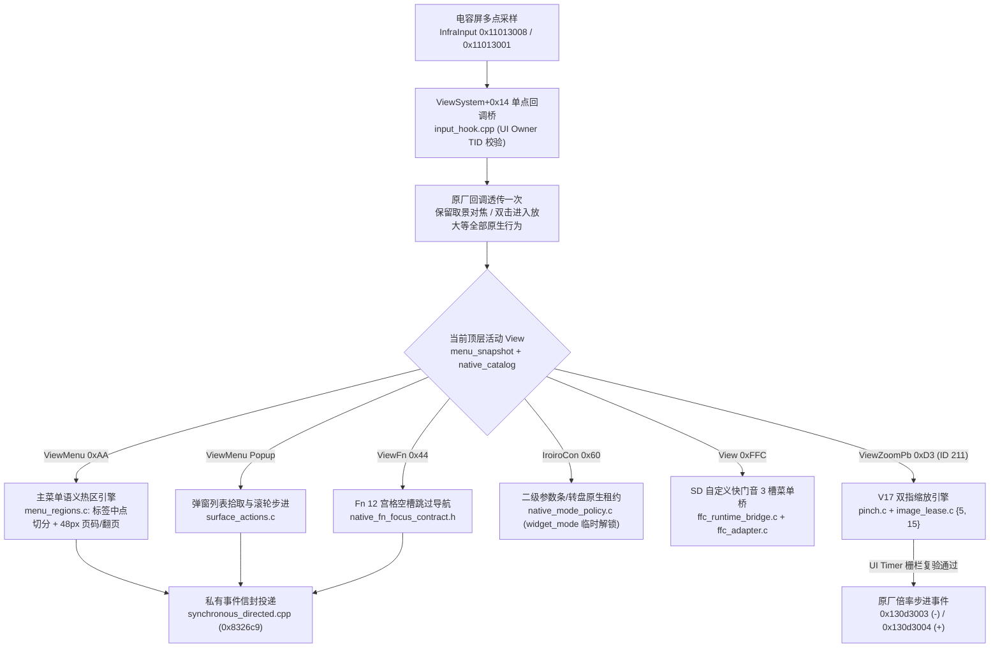
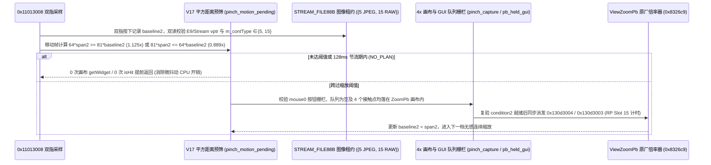

# `a7r3-full-touch` — 索尼 α7R III (FW 3.10) 全界面触控路由与双指缩放系统 (V17)

`a7r3-full-touch` 是面向 **Sony Alpha 7R III (`ILCE-7RM3`, 固件版本 `3.10`)** 的用户态 UI 触控接管与手势合成引擎，支持系统主菜单（`MENU` `0xAA`）、`Fn` 快捷面板（`0x44`）、二级参数滑条与拨轮（`IroiroCon` `0x60`）、原生自定义菜单（[`a7r3-native-ui`](https://github.com/kan-xx/a7r3-native-ui) 中的 `View 0xFFC`），以及回放放大视图（`ViewZoomPb` `0xD3`）下的 JPEG 与 `.ARW` RAW 双指捏合缩放。

> [!IMPORTANT]
> **净室构建声明**：本仓库仅包含独立编写的 C / C++ 源码、构建脚本与离线验证集，不包含任何原厂共享库（`libObj.so`、`viewUnified*.so`）或固件二进制。外部固件指令仿真通过环境变量 `A7R3_FW_ROOT` 以只读方式引用。

---

## 免责声明

> 大家请以学习为目的使用本仓库⚠️⚠️⚠️⚠️，[安全研究法律边界与合规须知](./DISCLAIMER.md#法规与合规参考)
>
> 本仓库的所有内容仅供学习和参考之用，禁止用于商业用途。任何人或组织不得将本仓库的内容用于非法用途或侵犯他人合法权益。本仓库所涉及的固件分析、系统逆向与硬件接口研究技术仅用于个人合法自有设备上的学习与研究，不得用于未经授权侵入或破坏他人设备、绕过技术保护措施、提取或传播第三方专有固件或其他非法行为。对于因使用本仓库内容而引起的任何法律责任、硬件损坏（变砖）、数据丢失或保修失效，本仓库及作者不承担任何责任。使用本仓库的内容即表示您同意本免责声明的所有条款和条件。
>
> 点击查看更为详细的免责声明。[点击跳转](./DISCLAIMER.md)

---

## 设计概览

尽管机身硬件与底层 `InfraInput` 管线原生支持多点触控坐标上报，但原厂用户态 UI 框架并未开放主菜单触控事件使能位，亦未内置回放视图的双指缩放识别器。`a7r3-full-touch` 不修改内核输入驱动，也不静态改写任何原厂 UI 库代码段（`.text`）或虚函数表（`vtable`），而是作为可选扩展模块在系统完成启动自检后通过外部签名清单（`A7TBM001`）按需加载至内存。

在运行态中，引擎仅在 `ViewSystem + 0x14` 处建立单点输入回调桥：每次触控采样首先原样透传给原厂处理器，完整保留取景对焦与双击放大等原生行为；随后根据当前顶层活动视图分流至对应的语义路由层。为消除直接注入 UI 事件与原厂异步鼠标队列之间的竞态，菜单及弹窗点击统一经过 `20 ms` 单次定时器排空栅栏（`rt_fence_guard`）确认队列空闲后再行投递；回放放大视图下的双指捏合则结合平方距离几何预筛、图像流租约校验（覆盖 JPEG `type 5` 与 RAW `type 15`）及画布持锁状态证明，合成原生倍率步进指令。

整套状态机与控件命中语义均配套了基于 Unicorn 的 ARM32 原码验证脚本与宿主机离线单元测试，使控件树模式锁、顶部标签几何重叠与内容类型分支在部署前即可离线核验。

---

## 一、原厂触控限制分析与逆向结论

Sony α7R III 搭载的电容触控屏硬件与底层 `InfraInput` 管线本身支持多点触控采样（`0x11013008` 原始触控帧可同时上报双指坐标与接触掩码），但在应用层 `libObj.so` + `viewUnified2/3/4.so` 中被施加了三层软件门禁：

1. **控件树模式锁（`widget_mode == 3`）**：Unicorn ARM32 逐指令验证（[`widget_mode_arm_test.py`](verifiers/widget_mode_arm_test.py) 与 [`widget_event_filter_arm_test.py`](verifiers/widget_event_filter_arm_test.py)）证明，`libObj.so` 的命中遍历（`0x5ccc31`）与最终模式求值（`0x5e239d`）计算 `final_mode = max(ancestor.mode)`；一旦 `MenuSelectMode`（`0x54b178`）或 `BarCtrlDial`（`0x530790`）祖先节点处于 `mode == 3`，所有 `press`（`0x5cda2a`）/ `release`（`0x5cd91a`）事件均被静默丢弃。
2. **主菜单微距热区与 5px 重叠缺陷**：原厂 `ViewMenu`（`0xAA`，`640×480` 逻辑面板）顶部 7 个分类标签宽 `91px`、中心间距仅 `86px`，相邻标签天然存在 **5px 几何重叠**；底部页码圆点高度仅 `14px`，左右翻页箭头仅 `8×16px`，直接按原厂几何框拾取极易误触。
3. **回放缩放缺少双指识别器且内容类型离散分离**：`ViewSinglePb`（`0xAF`）支持双击进入 `ViewZoomPb`（`0xD3`），但 `ViewZoomPb` 内部仅有拨轮步进事件（`0x130d3003` 缩小 / `0x130d3004` 放大，对应 `ZoomParameter` 18 档倍率表 `100%..800%`），没有双指跨度状态机；同时双卡槽/RAW 拍摄下 `GetRAWFileInfo` 将普通 JPEG 映射为 `m_contType = 5`，而将 `.ARW` RAW 映射为离散枚举 `m_contType = 15`（[`verify_native.py`](verifiers/verify_native.py)）。

---

## 二、系统架构与输入路由管线



### V17 回放双指捏合（Pinch-to-Zoom）快速路径状态机



---

## 三、仓库目录结构

```text
a7r3-full-touch/
├── touch-core/                         # 34-TU 核心运行时与 128B 启动清单封印器
│   ├── build_core.py                   # 自包含 Zig ARMv7 编译与 A7TBM001 封印 CLI
│   ├── elf_tools.py                    # 纯标准库 32-bit ARM ELF 解析、DT_RELCOUNT=0 归一化与 PLT 解码器
│   └── src/                            # 完整 107 个 C/C++ 源码与头文件闭包 + liba7r_touch_full_runtime_v7.so.map
├── service-sidecar/                    # Senser 0xF910 诊断/控制侧车与主机性能解码器
│   ├── senser_f910.c                   # libproF9.so 入口（支持 op 1..12 全指令集）
│   ├── service_provider.{c,h}          # 双槽句柄仲裁、UI 线程投递与 op12 七文件自启动进度发现
│   ├── libproF9.so.map                 # 仅导出 commandF910 的符号版本脚本
│   ├── codec.py                        # 主机端 128B 请求 / 26,476B op2 报告 / 488B op12 发现编解码器
│   ├── decode_v17_performance.py       # V17 16 槽微秒级性能计数器（含 RP Slot 15）前后差分分析器
│   └── telemetry-pinch-layout.json     # V16/V17 遥测字偏移映射表
├── observers/                          # 3 个触控与回放只读诊断观察器（零目标进程内存写入）
│   ├── build_observers.py              # 参数化 ARMv7 观察器交叉编译脚本
│   ├── ro211-observer-v14/             # 回放 ViewZoomPb (ID 211) E9 模型与图像流观察器
│   ├── ct-input-watch/                 # 冷启动触控帧与 mouse0 队列环形观察器
│   └── touch-observer-r2/              # A7TOBS01 触控采样与回调延迟环形记录器
├── verifiers/                          # 5 个参数化 Unicorn ARM32 原厂指令验证器
│   ├── unicorn_arm_env.py              # 自包含 Unicorn ARM32 加载与 PLT 桩拦截环境
│   ├── widget_mode_arm_test.py         # MenuSelectMode / BarCtrlDial mode==3 粘性锁指令证明
│   ├── widget_event_filter_arm_test.py # libObj.so 命中遍历、max(mode) 与事件冒泡证明
│   ├── verify_native_fn_direction.py   # viewUnified4.so Fn 12 宫格空槽跳过环绕证明
│   ├── verify_native_table.py          # libObj.so ZoomParameter 18 档倍率表 (100..800) 证明
│   └── verify_native.py                # GetRAWFileInfo -> m_contType {5, 15} JPEG/RAW 资格链证明
└── tests/                              # 零固件依赖离线主机单元测试套件（ASan + UBSan + Python）
    ├── run_all_tests.py                # `make test` 统一离线测试入口
    ├── test_runtime_pinch.c            # 89 组 V17 双指缩放状态机、异常恢复与 NO_PLAN 早退测试
    ├── test_capture.c                  # 108 组 4x 画布归属与父子 vptr/槽位防篡改测试
    ├── test_held_gui.c                 # 48 组 mouse0 令牌与输入队列栅栏测试
    ├── geometry.c                      # 32 项平方距离阈值 (9/8, 8/9)、最小跨度与 128ms 节流边界测试
    ├── dispatch_profile.cpp            # V17 RP Slot 15 正常返回计时与 C++ 异常豁免测试
    ├── test_menu_regions.c             # 640x480 主菜单 7 标签 0.5px 步进零重叠证明与 48px 页码/箭头测试
    ├── test_boot_manifest_and_lease.c  # 128B A7TBM001 校验器与 {5, 15} JPEG/RAW 图像租约切换测试
    └── test_sidecar_and_manifest.py    # F910 协议编解码、V17 性能差分与 ELF 清单封印器测试
```

---

## 四、快速开始：离线测试与交叉编译

### 1. 运行离线单元测试（无需任何索尼固件文件）

本仓库所有核心算法、协议编解码器、菜单几何切分、图像租约与双指缩放状态机均配备主机端 `clang`/`clang++`（开启 `AddressSanitizer` + `UndefinedBehaviorSanitizer`）及 Python 离线测试：

```bash
make test
```

### 2. 交叉编译相机端 DSO 与 128B 启动清单（需自备提取的 3.10 固件根目录）

安装 [Zig](https://ziglang.org/)（提供零配置 `arm-linux-gnueabi` 交叉编译链）后，通过 `A7R3_FW_ROOT` 指向自行提取的 α7R III `3.10` 固件根目录：

```bash
# 编译 liba7r_touch_full_runtime_v7.so (161,576 B) 与 libproF9.so (7,188 B)
make build-core A7R3_FW_ROOT=/path/to/extracted-a7r3-fw-3.10

# 可选：同时封印 128 字节冷启动清单 a7r_touch_boot_v1.bin (A7TBM001)
python3 touch-core/build_core.py \
  --fw-root /path/to/extracted-a7r3-fw-3.10 \
  --owner-sha256 <64-hex-autoload-owner-sha256> \
  --install-nonce <32-hex-install-nonce> \
  --out-dir build

# 编译只读诊断观察器
make build-observers A7R3_FW_ROOT=/path/to/extracted-a7r3-fw-3.10
```

在标准 Zig `0.15.x` 与 FW `3.10` sysroot 下，`touch-core/build_core.py` 从仓库内部源码直接复现与实机验收完全一致的确定性产物：
- `liba7r_touch_full_runtime_v7.so`：`161,576` 字节，SHA-256 `27db98355ef6cbadd22e619c2d294a40407a2bf59cf320d8d48882680ea64a45`
- `libproF9.so`：`7,188` 字节，SHA-256 `10b41c23dad317f90dd855698bef14777438b31692be0f633f6e73e2abe55fe7`

### 3. 运行 Unicorn ARM32 原厂固件验证器（可选）

若环境中已安装 `unicorn`（`pip install unicorn`），可直接对自备固件中的 `libObj.so` / `viewUnified2..4.so` 执行指令级契约验证：

```bash
make verify-unicorn A7R3_FW_ROOT=/path/to/extracted-a7r3-fw-3.10
```

---

## 五、V1 → V17 演进与实机验收数据

| 阶段 / 版本 | 关键技术突破 | 实机验收结果 |
| :--- | :--- | :--- |
| **V1 – V6** | 打通 `ViewSystem+0x14` 单点回调挂钩、`ViewMenu` (`0xAA`) 行聚焦激活、`Fn` (`0x44`) 12 宫格空槽跳过与二级 `IroiroCon` (`0x60`) 拨轮条解锁 | 主菜单、弹窗、`Fn` 与二级参数条触控全通 |
| **V7 – V10** | 引入 `A7TBM001` 128B 冷启动封印清单、分块有界文件哈希（`bounded_file_hash`）与 `menu_regions.c` 顶栏中点切分 + `48px` 页码/翻页热区扩展 | 冷启动自动挂载稳定，彻底消除顶栏 5px 误触与底部小圆点漏触 |
| **V12 – V15** | 实现 `ViewZoomPb` (`0xD3`) 双指跨度识别器、`4x` 画布归属证明（`pinch_capture.c`）、`mouse0` 按钮栅栏（`pb_held_gui.c`）与 `viewUnified3.so` 第 7 文件完整性校验 | JPEG 回放双指放大/缩小首次闭环通过，零崩溃、零残留句柄 |
| **V16** | 逆向 `GetRAWFileInfo` 链路，将图像租约升级为离散枚举 `{5 (JPEG), 15 (RAW)}`（`STREAM_FILE88B`），拒绝视频 `18` 等非静态媒体 | 单卡 RAW 与双卡 JPEG+RAW 回放双指缩放全部实机通过 |
| **V17 (当前)** | 1) 主菜单快速路径跳过冗余 `menu_snapshot` 采集；<br/>2) 回放 `NO_PLAN` 几何预筛前置，未达阈值帧跳过 `4x` 画布查询；<br/>3) 新增 `RP Slot 15` 原厂缩放派发耗时探针 | 主菜单点击回调峰值由 **`5,606 µs` 降至 `1,152 µs`（提速 4.86×）**；回放 `post` 峰值 `527 µs`，`fence` 峰值 `1,720 µs`，原厂倍率返回 `845 µs` |

---

## 六、已知边界与安全约束

1. **固件版本强绑定**：所有对象偏移与 SHA-256 锚点严格绑定 `ILCE-7RM3` 固件 **`3.10`**；若检测到任何目标库大小、inode 或 SHA-256 不匹配，自启动状态机会在挂载前自动中止并保持原厂行为（Fail-Closed）。
2. **单指平移保持原厂接管**：在 `ViewZoomPb` 放大状态下，单指拖拽平移图像完全交由原厂 `MouseArea` 原生逻辑处理；本模块仅在检测到合法双指接触（`held_mask` 恰为两指）且跨过 `9/8` / `8/9` 几何阈值时触发离散倍率步进。
3. **不持久化篡改原厂组件**：本仓库不包含任何 NAND 分区刷写脚本，亦不修改任何 Sony 原厂二进制文件。
